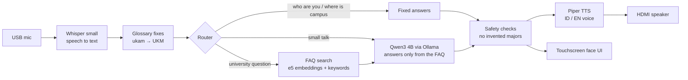

<div align="center">

# MIRAI

### AI lobby guide robot for BINUS ASO School of Engineering

Ask it a question in Bahasa Indonesia or English. It looks up the answer in the official FAQ and says it out loud.<br>The whole thing runs on the robot's Jetson, so it works without an Internet connection.


Designed and built by Yours Truly

</div>

## A visit, start to finish

1. MIRAI sits on the touchscreen with its eyes dozing until someone touches it.
2. The visitor picks Indonesian or English and taps Mulai Bertanya. They can also open Topik Populer for ready-made questions, or type on the on-screen keyboard.
3. They ask out loud, for example *"Apa saja UKM di BINUS ASO?"* Recording stops on its own when they stop talking.
4. MIRAI turns the speech into text, corrects campus words it tends to mishear, and searches the FAQ.
5. The answer shows up on screen and plays through the speaker, usually in one or two short sentences.
6. Tapping Selesai, or leaving it alone for 2 minutes, clears the conversation for the next person.

## How it works



| Stage | What it uses | Why we picked it |
|---|---|---|
| Listen | [faster-whisper](https://github.com/SYSTRAN/faster-whisper) `small`, CPU int8, voice-activity filter | 20% word errors on our kiosk recordings, against 38% for `base` |
| Fix campus words | [`glossary.json`](glossary.json), built from real mishearings on the kiosk | Whisper hears "the base" for D'BASE and "ukam" for UKM |
| Find the answer | `multilingual-e5-small` (INT8 ONNX) plus a 10% keyword score, chunked by FAQ entry | The right FAQ entry is in the top 3 for 98% of ~60 bilingual test questions |
| Write the answer | Qwen3 4B Instruct 2507 (Q4_K_M) on the GPU via [Ollama](https://ollama.com) | Fits in 8 GB and handles both languages well |
| Speak | [Piper](https://github.com/rhasspy/piper) `id_ID-news_tts-medium` / `en_US-lessac-medium` | Fast offline voices, tuned by ear on the robot |
| Show | FastAPI plus plain HTML/CSS/JS in Firefox kiosk mode | No build step and no assets loaded from the Internet |

## What it does well

- It works offline. The LLM, speech recognition, voices and search all run on the Jetson.
- University facts come only from the FAQ. When the FAQ has no answer, MIRAI apologises and suggests asking the staff nearby. If a reply names a major BINUS ASO doesn't offer, MIRAI swaps in the real list of three.
- You can ask in English about the Indonesian FAQ. The reply comes back in whichever language the visitor picked.
- Follow-ups like *"program itu"* or *"which one?"* work because MIRAI keeps the current conversation in RAM. Ending the visit wipes it.
- It fits in 8 GB: quantized ONNX embeddings, a small context window, and models that stay loaded so the first visitor doesn't wait. The page speaks each sentence while the next one is still being generated.
- The face is a glowing box with eyes that sleep, listen, think, look confused and smile when tapped. Answers appear inside the box.
- There are 191 pytest tests, plus evaluation scripts for retrieval, a 26-turn conversation and speech recognition.

## Hardware

| Part | What MIRAI uses |
|---|---|
| Computer | NVIDIA Jetson Orin Nano 8 GB (JetPack 6, Ubuntu 22.04) |
| Screen | Touchscreen monitor over HDMI/DisplayPort, with a separate USB cable for touch |
| Microphone | USB microphone |
| Speaker | The monitor's speakers, over HDMI/DisplayPort |

## Quick start on the Jetson

```bash
cd ~/Documents/MIRAI-Jetson
bash scripts/install_jetson.sh       # one time: Python env, Ollama, Qwen, Whisper, Piper voices, tests
bash scripts/install_autostart.sh    # one time: open MIRAI automatically at login
bash scripts/start_kiosk.sh          # start now (server + full-screen face UI)
```

The installer downloads about 6 GB and needs 15 GB of free space. To move the project over from a laptop, see [JETSON_START_HERE.md](JETSON_START_HERE.md).

### Everyday commands

| To | Run |
|---|---|
| Update to the latest code | `pkill -f start_kiosk.sh; pkill -f server.py; bash scripts/update_jetson.sh && bash scripts/start_kiosk.sh` |
| Close the kiosk | `Alt+F4`, then `pkill -f start_kiosk.sh; pkill -f server.py` |
| Run only the server (e.g. over SSH) | `bash scripts/start_kiosk.sh --server-only`, then open http://127.0.0.1:8000 |
| See what happened at boot | `tail -n 50 .mirai/kiosk.log` |
| Check RAM and GPU | `free -h`, `ollama ps`, `tegrastats` |
| Check sound | `bash scripts/check_audio.sh --play` |
| Ask from the terminal | `bash scripts/start.sh -q "Apa saja UKM di BINUS ASO?"` |

On a cold boot the server takes a few minutes to load, and the kiosk script waits for it. It then sets the USB mic as the default input and the first HDMI output as the default speaker before opening the browser.

## HTTP API

The kiosk page uses these endpoints on `http://127.0.0.1:8000`, and the robot's ROS side can call them too:

| Endpoint | Does |
|---|---|
| `POST /api/ask` `{text, language}` | Answer a question |
| `POST /api/transcribe` (multipart `audio`) | Speech to text |
| `POST /api/speak` `{text, language}` | Text to WAV |
| `POST /api/cancel` | Drop the answer being prepared |
| `POST /api/reset` | Forget the current visitor |
| `GET /api/status` | Ready or busy |

## Project layout

```text
server.py        FastAPI kiosk server: loads every model once, serves static/ and the API
assistant.py     The brain: routing, follow-ups, search, safety checks on the answer
llm.py           Ollama chat, MIRAI's persona and prompts, fallback replies
retriever.py     FAQ-aware chunking + hybrid search (embeddings + keywords)
embeddings.py    e5 model specs, ONNX encoder, calibrated score cut-offs
speech.py        Whisper transcription and Piper voices
glossary.py      Fixes misheard campus words and adds search hints (glossary.json)
memory.py        Per-visitor conversation memory (in-RAM SQLite)
config.py        All defaults in one place
static/          The face UI (index.html, style.css, app.js, recorder.js, bundled font)
data/pdfs/       The BINUS ASO FAQ PDF, the only source of university facts
scripts/         Install, kiosk start, autostart, update, evaluation and check scripts
tests/           pytest suite
```

## Checks

```bash
.venv/bin/python -m pytest -q                              # 191 tests, no models needed
.venv/bin/python scripts/eval_retrieval.py --backend onnx  # does each question find the right FAQ?
.venv/bin/python scripts/eval_conversation.py              # 26-turn conversation with the real model
.venv/bin/python scripts/eval_stt.py                       # Whisper accuracy on recorded questions
.venv/bin/python scripts/smoke_test.py --live --voice      # end-to-end with temporary PDFs
```

Run `eval_retrieval.py` again whenever you edit the FAQ PDF or `glossary.json`.

## Troubleshooting

| Problem | Try |
|---|---|
| No sound | Check the monitor's own volume, mute and input first, then `pactl get-default-sink` and `bash scripts/check_audio.sh --play` |
| Mic hears nothing | `pactl get-default-source` should name the USB mic. Press `F5` in the kiosk to pick it up again |
| Touch does nothing | HDMI only carries the picture, so the touch panel needs its own USB cable to the Jetson. Look for a touch device in `xinput list` |
| Touching moves the cursor on another screen | `xinput map-to-output "<touch device name>" <HDMI output from xrandr>` |
| `Out of memory: Killed process` | Close other apps and browsers. The kiosk already uses the low-memory profile |
| `[Errno 98] Address already in use` | Autostart already started a server. Run `pkill -f server.py` first |
| Firefox won't open after a snap update | Keep snapd on hold: `snap refresh --hold snapd` |
| A campus word keeps being misheard | Add the misheard spelling to `glossary.json` as an alias |

## Tuning

All defaults live in [`config.py`](config.py), and you can override them on the command line, e.g. `bash scripts/start_kiosk.sh --idle-timeout 180 --whisper-model base`.

- `--whisper-model base` is about twice as fast but makes nearly twice as many mistakes.
- `--min-confidence` sets how unsure Whisper can be before MIRAI asks the visitor to repeat. Add `--verbose` to see the scores.
- `--max-tokens`, `--num-ctx` and `--top-k` control answer length, context size and how many FAQ entries go to the model.
- Whisper runs on the CPU because the pip build of CTranslate2 has no CUDA support on Jetson. Switching to whisper.cpp with CUDA would be the next speed-up.

<div align="center">

Rebuilt from the text-only prototype [`Skyresist/BASE-Core-AI-LLM`](https://github.com/Skyresist/BASE-Core-AI-LLM) for BINUS ASO School of Engineering.

</div>
