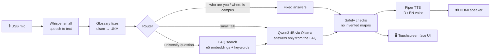

<div align="center">

# 🤖 MIRAI

### The AI lobby guide robot for BINUS ASO School of Engineering

**Talk to it in Bahasa Indonesia or English. It listens, finds the answer in the official FAQ, and speaks back.<br>Everything runs on the robot itself. No cloud and no Internet.**


*Designed and built by **Clayvent Yuuki William** · BCore AI Research Club*

</div>

---

## ✨ What a visit looks like

1. 💤 **MIRAI is asleep.** Its glowing eyes doze on the touchscreen until someone touches it.
2. 🇮🇩 / 🇬🇧 **The visitor picks a language** and taps **Mulai Bertanya**, or opens **Topik Populer**, or types on the on-screen keyboard.
3. 🎙️ **They ask out loud.** *"Apa saja UKM di BINUS ASO?"* Recording stops by itself when they stop talking.
4. 🧠 **MIRAI thinks.** It transcribes the speech, fixes campus words it often mishears, and searches the FAQ.
5. 🔊 **MIRAI answers** on screen and out loud, in one or two short, friendly sentences.
6. 👋 **"Selesai"**, or 2 minutes of no activity, wipes the conversation so the next visitor starts fresh.

## 🧩 How it works



| Stage | What it uses | Why |
|---|---|---|
| **Listen** | [faster-whisper](https://github.com/SYSTRAN/faster-whisper) `small`, CPU int8, voice-activity filter | 20% word errors on our kiosk recordings vs 38% for `base` |
| **Fix campus words** | [`glossary.json`](glossary.json), built from real mishearings on the kiosk | Whisper hears "the base" for D'BASE and "ukam" for UKM |
| **Find the answer** | `multilingual-e5-small` (INT8 ONNX) + 10% keyword score, FAQ-aware chunks | Right FAQ in the top 3 for **98%** of ~60 bilingual test questions |
| **Write the answer** | Qwen3 4B Instruct 2507 (Q4_K_M) on the GPU via [Ollama](https://ollama.com) | Small enough for 8 GB, good in both languages |
| **Speak** | [Piper](https://github.com/rhasspy/piper) `id_ID-news_tts-medium` / `en_US-lessac-medium` | Fast offline voices, tuned by ear on the robot |
| **Show** | FastAPI + plain HTML/CSS/JS in Firefox kiosk mode | No build step, no Internet assets |

## 🌟 Highlights

- 🔒 **Fully offline.** The LLM, speech recognition, voices and search all run on the Jetson.
- 📚 **Grounded, not made up.** MIRAI only states university facts it found in the FAQ. If the answer isn't there, it says sorry and points to the staff nearby. If an answer names a major BINUS ASO doesn't have, it gets replaced with the real three.
- 🗣️ **Bilingual both ways.** You can ask in English about an Indonesian FAQ, and the reply comes back in the language you picked.
- 🧠 **Remembers the conversation, then forgets the visitor.** Follow-ups like *"program itu"* or *"which one?"* work. The memory lives only in RAM and is wiped when the visit ends.
- ⚡ **Built for 8 GB.** Quantized ONNX embeddings, a small context window, models kept loaded so the first visitor never waits, and each sentence is spoken while the next one is generated.
- 🎨 **A face, not a form.** A glowing face box with eyes that sleep, listen, think, get confused and smile when tapped. The answers appear inside the box.
- 🧪 **Tested.** 191 pytest tests, plus evaluation scripts for retrieval, 26-turn conversations and speech recognition.

## 🛠️ Hardware

| Part | Used for MIRAI |
|---|---|
| Computer | NVIDIA Jetson Orin Nano 8 GB (JetPack 6, Ubuntu 22.04) |
| Screen | Touchscreen monitor over HDMI/DisplayPort, plus a USB cable for touch |
| Microphone | USB microphone |
| Speaker | The monitor's speakers over HDMI/DisplayPort |

---

## 🚀 Quick start (Jetson)

```bash
cd ~/Documents/MIRAI-Jetson
bash scripts/install_jetson.sh       # one time: Python env, Ollama, Qwen, Whisper, Piper voices, tests
bash scripts/install_autostart.sh    # one time: open MIRAI automatically at login
bash scripts/start_kiosk.sh          # start now (server + full-screen face UI)
```

The installer needs about 6 GB of downloads and 15 GB of free space. See [JETSON_START_HERE.md](JETSON_START_HERE.md) for moving the project from a laptop.

### Day-to-day commands

| I want to… | Run |
|---|---|
| Update to the latest code | `pkill -f start_kiosk.sh; pkill -f server.py; bash scripts/update_jetson.sh && bash scripts/start_kiosk.sh` |
| Close the kiosk | `Alt+F4`, then `pkill -f start_kiosk.sh; pkill -f server.py` |
| Run only the server (e.g. over SSH) | `bash scripts/start_kiosk.sh --server-only`, then open http://127.0.0.1:8000 |
| See what happened at boot | `tail -n 50 .mirai/kiosk.log` |
| Check RAM / GPU | `free -h`, `ollama ps`, `tegrastats` |
| Check sound | `bash scripts/check_audio.sh --play` |
| Ask from the terminal | `bash scripts/start.sh -q "Apa saja UKM di BINUS ASO?"` |

When the kiosk starts, it waits for the server to finish loading (a cold boot takes a few minutes). It then makes the USB mic the default input and the first HDMI output the default speaker, and opens the browser.

## 🔌 HTTP API

The kiosk page and the robot's ROS side can use the same endpoints on `http://127.0.0.1:8000`:

| Endpoint | Does |
|---|---|
| `POST /api/ask` `{text, language}` | Answer a question |
| `POST /api/transcribe` (multipart `audio`) | Speech → text |
| `POST /api/speak` `{text, language}` | Text → WAV |
| `POST /api/cancel` | Drop the answer being prepared |
| `POST /api/reset` | Forget the current visitor |
| `GET /api/status` | Ready / busy |

## 🗂️ Project layout

```text
server.py        FastAPI kiosk server: loads every model once, serves static/ and the API
assistant.py     The brain: routing, follow-ups, search, safety checks on the answer
llm.py           Ollama chat, MIRAI's persona and prompts, fallback replies
retriever.py     FAQ-aware chunking + hybrid search (embeddings + keywords)
embeddings.py    e5 model specs, ONNX encoder, calibrated score cut-offs
speech.py        Whisper transcription and Piper voices
glossary.py      Fixes misheard campus words and adds search hints (glossary.json)
memory.py        Per-visitor conversation memory (in-RAM SQLite)
config.py        All defaults in one place
static/          The face UI (index.html, style.css, app.js, recorder.js, bundled font)
data/pdfs/       The BINUS ASO FAQ PDF, the only source of university facts
scripts/         Install, kiosk start, autostart, update, evaluation and check scripts
tests/           pytest suite
```

## 🧪 Checks

```bash
.venv/bin/python -m pytest -q                              # 191 tests, no models needed
.venv/bin/python scripts/eval_retrieval.py --backend onnx  # does each question find the right FAQ?
.venv/bin/python scripts/eval_conversation.py              # 26-turn conversation with the real model
.venv/bin/python scripts/eval_stt.py                       # Whisper accuracy on recorded questions
.venv/bin/python scripts/smoke_test.py --live --voice      # end-to-end with temporary PDFs
```

Run `eval_retrieval.py` again after you edit the FAQ PDF or `glossary.json`.

## 🩺 Troubleshooting

| Problem | Try |
|---|---|
| No sound | Check the monitor's own volume/mute and input, then `pactl get-default-sink` and `bash scripts/check_audio.sh --play` |
| Mic hears nothing | `pactl get-default-source` should name the USB mic. Press `F5` in the kiosk to grab it again |
| Touch does nothing | The touch panel needs its own USB cable to the Jetson (HDMI only carries the picture). Check `xinput list` for a touch device |
| Touching moves the cursor on another screen | `xinput map-to-output "<touch device name>" <HDMI output from xrandr>` |
| `Out of memory: Killed process` | Close other apps and browsers. The kiosk already uses the low-memory profile |
| `[Errno 98] Address already in use` | A server is already running from autostart. `pkill -f server.py` first |
| Firefox won't open after a snap update | Keep snapd held: `snap refresh --hold snapd` |
| A campus word keeps being misheard | Add the misheard spelling to `glossary.json` as an alias |

## ⚙️ Tuning

Everything is in [`config.py`](config.py) and can be overridden on the command line, e.g. `bash scripts/start_kiosk.sh --idle-timeout 180 --whisper-model base`.

- `--whisper-model base` is about twice as fast, but mishears almost twice as often.
- `--min-confidence` sets how unsure Whisper may be before MIRAI asks the visitor to repeat. Use `--verbose` to see the scores.
- `--max-tokens`, `--num-ctx` and `--top-k` control answer length, context size and how many FAQ entries are used.
- Whisper runs on the CPU, because the pip build of CTranslate2 has no CUDA on Jetson. Moving to whisper.cpp with CUDA is the next speed-up.

---

<div align="center">

Rebuilt from the text-only prototype [`Skyresist/BASE-Core-AI-LLM`](https://github.com/Skyresist/BASE-Core-AI-LLM) · Made with ❤️ for BINUS ASO School of Engineering

</div>
